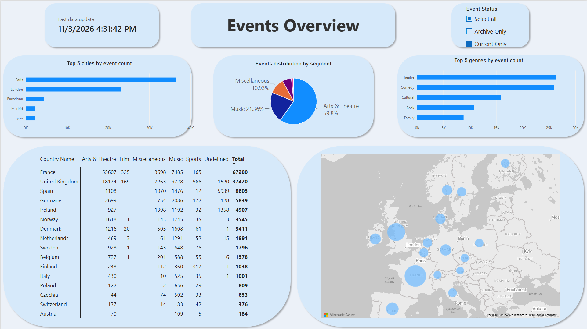
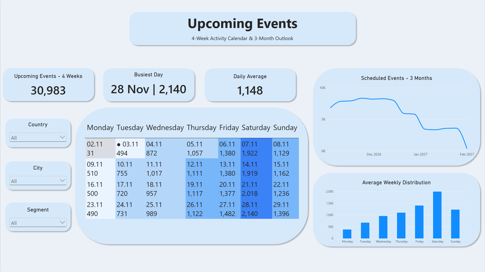
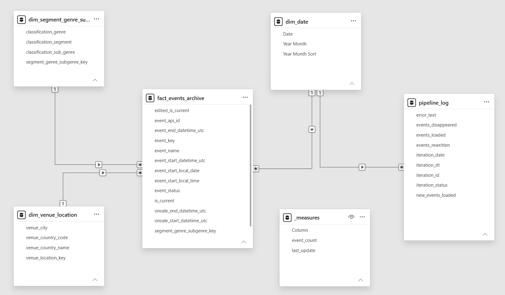

# Ticketmaster Events Explorer

A Python and MySQL pipeline with a Power BI dashboard for exploring event listings across 16 European countries.

## Project Overview

I wanted to work with data that changes over time rather than use a ready-made CSV once. I chose Ticketmaster to build a repeatable collection process and explore how its listings are distributed across countries, cities and categories.

The project covers collection, cleaning, database storage, modeling and visualization. The main questions are:

- Where are the collected events concentrated?
- Which categories dominate, and does the mix change between countries?
- Which cities and genres lead within a selected country or category?

**Tools:** Python, pandas, Requests, SQLAlchemy, MySQL, Power Query and Power BI.

## Dashboard

### Events Overview



The **Events Overview** page includes a country map, a country-by-category matrix, category shares, and the top five cities and genres by event count. Selecting a country or category lets me explore a smaller part of the dataset. For example, selecting Spain and Music shows the cities and genres represented in those listings.

The Event Status filter separates records by their presence in the latest completed feed load:

- **Current Only:** events present in that load.
- **Archive Only:** previously collected events absent from that load.
- Selecting both includes all retained records.

These options do not indicate whether tickets are on sale or whether an event is upcoming, completed or cancelled.

### Upcoming Events



The **Upcoming Events** page shows when events in the latest feed are scheduled. I can filter by country, city or segment to see which dates have the most listings.

The calendar shows four Monday-to-Sunday weeks, starting with the current week. A dot marks today's date, and darker blue cells indicate more events. Earlier dates in the current week stay visible for context. Their counts can change as listings disappear from the feed.

- **Upcoming Events – 4 Weeks** counts events from today through the final Sunday on the calendar.
- **Busiest Day** shows the date with the most events in that period and the event count.
- **Daily Average** divides the upcoming event count by the number of remaining calendar days, including today.

**Average Weekly Distribution** compares weekdays across all four displayed weeks. **Scheduled Events – 3 Months** groups the listings already in the feed by week over the next three months.

## Data Source

The pipeline downloads compressed JSON files from the [Ticketmaster Discovery Feed](https://developer.ticketmaster.com/products-and-docs/apis/discovery-feed/), separately for each country.

The countries included are Austria, Belgium, Czechia, Denmark, Finland, France, Germany, Ireland, Italy, the Netherlands, Norway, Poland, Spain, Sweden, Switzerland and the United Kingdom.

The selected fields describe event IDs and names, dates, status, sales dates, venue location and classification. I began collecting data on **6 October 2026**. The archive cannot recover events that disappeared before collection began.

## Process

```text
Ticketmaster Discovery Feed
          ↓
Python: download, combine and clean
          ↓
MySQL: current data, archive and run log
          ↓
Power Query: prepare fact and dimension tables
          ↓
Power BI: explore the event listings
```

### Collection and preparation

Python downloads and decompresses the country files, normalizes the JSON and combines the results. An unsuccessful country request stops collection before the database load.

The preparation step selects the required columns, standardizes their names, converts date and time fields, and maps country codes to names. It also checks duplicate event IDs. If duplicate rows make up less than 0.1% of the input, it removes them; at or above that threshold, it stops for investigation. This is a rule I set for the pipeline, not a Ticketmaster quality standard.

### Storage

| Table | Purpose |
|---|---|
| `europe_data_current` | Data from the latest completed load |
| `europe_data_archive` | Previously collected events and their current-feed flag |
| `pipeline_log` | Run timestamps, outcomes and record counts |

Both event tables enforce unique, non-null event IDs with case-sensitive comparison. The current-data refresh, archive updates and successful-run log entry run in one transaction. A database-stage failure rolls back those changes and triggers a separate attempt to log the error.

### Power BI model



Power Query prepares the event fact table and dimensions for location and event classification. These dimensions filter the events through one-to-many relationships. A date dimension connects to the events and pipeline log, and measures are grouped in a separate table.

The dashboard uses an event-count measure for its comparisons and a last-update measure to display the latest successful load recorded in the imported pipeline log.

## Key Decisions

### Switching from Discovery API to Discovery Feed

I initially used the [Discovery API](https://developer.ticketmaster.com/products-and-docs/apis/discovery-api/v2/). Its pagination limits made bulk collection more complicated: I was splitting requests into date ranges, combining responses and checking for duplicates.

Discovery Feed was a better fit because it provides downloadable country files. I switched to combining those files into one European dataset, while keeping duplicate checks in the preparation step.

### Keeping events that disappear from the feed

Replacing the dataset after every refresh would lose events that no longer appear in the source. I added an archive to keep them available for potential future analysis.

New event IDs are inserted into the archive. Missing events are retained with `is_current = FALSE`; events that return are marked current again. The archive keeps **one record per event ID**, rather than a separate version for every change.

## Key Findings

These findings use the [country-by-category export](data/matrix.csv) with **Current Only** selected. It contains **141,720 counted event listings across 16 countries**. The accompanying dashboard displays a last data update of **30 October 2026, 11:21:04 AM**. These figures describe that saved view, not a live total. The PBIX file may contain a newer refresh, so its totals can differ from the screenshot and findings below.

- **France and the United Kingdom account for 74.2% of the listings.** France has 69,243 and the UK has 35,876. The overall distribution is heavily influenced by these two countries.
- **France contributes much of the large Arts & Theatre share.** This category accounts for 61.1% of all listings, and France contributes 66.2% of its total. Excluding France, Arts & Theatre still leads, but its share falls to 40.4%, compared with 31.7% for Music.
- **The overall mix does not describe every country.** Music accounts for 80.5% of listings in Poland, 78.1% in Czechia and 67.5% in the Netherlands. Country-level filtering reveals differences that the overall chart hides.
- **Undefined categories limit some comparisons.** Undefined represents 61.5% of Spanish listings and 33.2% of Irish listings. These events remain in the totals, but their category cannot be inferred from the export.

The main takeaway is that the overall category distribution needs country-level context. These are patterns in the collected Ticketmaster listings, not estimates of national market share or audience demand.

### Upcoming Events – 3 November 2026

The calendar covers **2-29 November 2026**, with country, city and segment all set to **All**.

- **30,983 events are scheduled from 3 to 29 November**, an average of **1,148 per day** over 27 days. The 31 listings shown for Monday 2 November fall outside this total.
- **Saturday is the busiest day of the week in all four weeks.** The four Saturdays have 1,922, 1,919, 2,018 and 2,140 listings, averaging about 2,000 per Saturday. Friday follows with an average of 1,405 and Sunday with 1,231.
- **Saturday 28 November has the most listings on any upcoming date**, with 2,140 events.
- **The feed shows fewer listings per week further into January 2027.** More events may be announced as those dates approach, and the final week in the chart may cover only part of a week. The outlook describes the listings available on 3 November and cannot establish a decline in attendance or ticket demand.

## Limitations

- Coverage is limited to the collected Ticketmaster feed. It is not a complete list of European events.
- The data does not include ticket quantities, sales volumes, attendance or venue capacity. Event counts cannot establish demand or occupancy.
- An event disappearing from the feed does not explain what happened to it. The pipeline records absence, not its cause.
- The archive does not preserve daily snapshots or a full change history. For existing records, it refreshes the local event date, UTC start datetime, status and current-feed flag; other attributes remain as initially stored.
- Collection history is too short for reliable historical seasonality comparisons. Fewer listings for distant dates may reflect how far ahead events are published.
- Findings were calculated from an aggregated export. It allows totals and shares to be checked, but does not independently verify event-ID uniqueness after Power Query transformations.
- Download and preparation errors are reported in the terminal; database-stage failures are also submitted to the run log.

## How to Run

The main project files are `pipeline.py`, `config_example.py`, `creating_db_and_table.sql` and `dashboard.pbix`. Screenshots are in `assets/`, and the export used for the findings is in `data/`.

### 1. Prepare the Python environment

The local environment uses **Python 3.12.4**. From the project folder on Windows, create an environment and install the same package versions:

```powershell
py -3.12 -m venv .venv
.\.venv\Scripts\python.exe -m pip install pandas==3.0.6 SQLAlchemy==2.1.3 requests==2.34.2 mysql-connector-python==26.7.0
```

### 2. Configure the source and database

1. Obtain your own Ticketmaster API credentials with access to Discovery Feed.
2. Run `creating_db_and_table.sql` in MySQL to create the `ticketmaster` database and its three tables.
3. Copy the configuration template in the project folder:

```powershell
Copy-Item config_example.py config_local.py
```

4. Open `config_local.py` and fill in `TICKETMASTER_API_KEY`, `TICKETMASTER_RESERVE_KEY`, `MYSQL_HOST`, `MYSQL_USER`, `MYSQL_PASSWORD` and `MYSQL_DATABASE`. The default database name is `ticketmaster`. The reserve key is used by the existing retry logic after an HTTP 429 response.

`pipeline.py` imports these settings from `config_local.py`; there is no need to put credentials in the pipeline itself. The repository includes `config_example.py` with blank credentials and default connection settings. Keep `config_local.py` on your computer: it is excluded by `.gitignore`. If uploading through the GitHub website, do not select this file manually.

### 3. Load the data

```powershell
.\.venv\Scripts\python.exe pipeline.py
```

Check the terminal output and latest entry in `pipeline_log` before refreshing the report.

### 4. Refresh Power BI

Open `dashboard.pbix` in Power BI Desktop. Configure the MySQL source to use your local server and database, provide your own credentials, and select **Refresh** after a successful pipeline run. Install the MySQL connector if your Power BI Desktop installation requests it.

I currently run the pipeline manually and then refresh Power BI manually. There is no scheduled refresh. Updating MySQL and refreshing the imported Power BI data are separate steps.

The package versions above were read from the local environment. Installation and database loading on a clean computer have not been independently tested.

## Future Improvements

I started working on a server deployment and plan to finish it by setting up a virtual machine for the Python pipeline and hosting the MySQL database on the server. Once both are in place, I plan to schedule the pipeline to fetch the Ticketmaster feed and update the database automatically.
